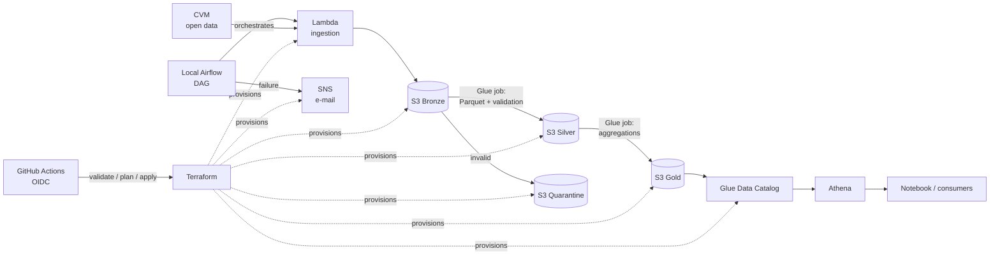

# aws-fundos-pipeline

[](https://github.com/thalesreiser/aws-fundos-pipeline/actions/workflows/ci.yml)


[](LICENSE)

> A data pipeline on **AWS**, 100% provisioned with **Terraform**, orchestrated by **Airflow** and shipped through **CI/CD**, that turns Brazilian Securities Commission (CVM) open data on investment funds into analytics tables queryable in Athena, for less than US$ 5 a month.

**Status:** 🚧 in progress · epic 1 of 7 (foundations and AWS account)

---

## Why this project exists

Every day CVM publishes a **daily report** for thousands of investment funds (share value, net assets, inflows, redemptions and number of shareholders), plus the **registry** of those funds. The data is rich, but it arrives as monthly CSV files, with no consolidated history and no quality guarantees.

This project builds the full path from source to query, with the practices expected from a production pipeline:

- **Infrastructure as code:** no resource is created by hand in the console
- **Idempotency:** reprocessing a month produces exactly the same result
- **Quality with quarantine:** invalid records are isolated, never silently dropped
- **Secure by default:** least privilege, encryption and CI without long-lived keys
- **Controlled cost:** budget with alerts and a documented `terraform destroy`

## Architecture



### S3 layout

```
s3://<project>-bronze/informe_diario/ano=2026/mes=09/inf_diario_fi_202609.csv
s3://<project>-bronze/cadastro/data_carga=2026-10-16/cad_fi.csv
s3://<project>-silver/informe_diario/ano=2026/mes=09/part-*.parquet
s3://<project>-quarantine/informe_diario/ano=2026/mes=09/...
s3://<project>-gold/indicadores_fundo_mes/ano=2026/mes=09/part-*.parquet
```

Partitioning by **year/month** lets a reference month be reprocessed by overwriting only its partition, which is what guarantees idempotency (RNF-01).

### Gold layer metrics

Per fund and per month:

| Metric | Definition |
|---|---|
| **Net assets** | Net asset value on the last business day of the month |
| **Net inflows** | Σ inflows − Σ redemptions in the period |
| **Share value change** | share value at month end ÷ share value at the previous month end − 1 |

The daily report key is **fund CNPJ + reference date** (RN-01).

## Technical highlights

| Topic | What is demonstrated |
|---|---|
| **Terraform** | Remote state backend, per-layer buckets with encryption and public access blocked, least-privilege IAM roles, Glue Database, SNS and AWS Budgets |
| **CI/CD** | `terraform fmt`, `validate` and `plan` on PRs; AWS authentication via **OIDC** (no stored access keys) |
| **Airflow** | DAG with dependencies, retries, backfill and idempotent re-runs |
| **Data quality** | **pandera** rules (schema, nulls, duplicates, ranges) and quarantine |
| **Tests** | Unit tests with pytest, integration with **moto** simulating S3, `tflint` |
| **Observability** | Structured logs and CloudWatch metrics, failure alerts by e-mail |

## Cost

| Resource | Strategy to keep cost low |
|---|---|
| Lambda, S3, Athena | Within or close to the free tier for this volume |
| Glue | Python shell jobs with minimum capacity, run on demand |
| Airflow | Runs **locally** in Docker. MWAA would have a fixed monthly cost (see ADR 002) |
| Safety net | AWS Budgets alert at 80% and `make tf-destroy` at the end of each session |

**Target:** US$ 5/month or less. The actual measured cost will be published here.

## Stack

| Layer | Technology |
|---|---|
| Ingestion | AWS Lambda (Python) |
| Storage | Amazon S3 (bronze, silver, gold, quarantine) |
| Transformation | AWS Glue (Python job) |
| Catalog and query | Glue Data Catalog + Amazon Athena |
| Orchestration | Apache Airflow (local Docker Compose) |
| IaC | Terraform |
| CI/CD | GitHub Actions + OIDC |
| Quality | pandera + pytest + moto |
| Observability | CloudWatch + SNS |

## Develop in GitHub Codespaces

[](https://codespaces.new/thalesreiser/aws-fundos-pipeline?quickstart=1)

The repository ships a dev container (`.devcontainer/`), so the whole environment runs in the cloud and nothing needs to be installed locally. The codespace is created on a 2-core / 8 GB machine with Python 3.11, Terraform, AWS CLI, Docker and make preinstalled; dependencies and pre-commit hooks are set up on creation.

```bash
aws configure sso   # short-lived credentials, never access keys (RNF-03)
make tf-plan        # validate and plan the infrastructure
make airflow-up     # local Airflow
```

Forwarded port: Airflow UI (8080).

Codespaces consume the monthly quota of the GitHub account: **stop** the codespace when you are not using it (it also stops after 30 minutes idle) and **delete** it at the end of a phase. The same configuration works locally with Docker Desktop and the VS Code *Dev Containers* extension.

## How to run

**Prerequisites:** an AWS account (with MFA and a non-root user), Terraform 1.6+, Docker and Python 3.11.

```bash
make tf-apply                     # provision the infrastructure
make airflow-up                   # start local Airflow
make trigger COMPETENCIA=2026-09  # process one month end to end
```

When you are done: **`make tf-destroy`**.

For development: `make install`, `make lint`, `make test` and `make tf-plan`.

## Repository layout

```
├── src/fundos_pipeline/
│   ├── ingestion/        # Lambdas: daily report and registry
│   ├── transform/        # Glue jobs: silver and gold
│   └── quality/          # pandera rules and quarantine
├── airflow/dags/         # orchestration DAG (separate from the logic)
├── infra/terraform/      # all AWS infrastructure
├── tests/                # unit and moto integration tests
├── notebooks/            # gold consumption example
├── docs/                 # requirements (01–06) and ADRs
└── .github/workflows/    # CI: Python + Terraform
```

## Roadmap

| Epic | Deliverable | Hours | Status |
|---|---|---|---|
| 1. Foundations and AWS account | Repository, secure account, Budgets, vision and requirements | 5 h | 🚧 |
| 2. Infrastructure as code | Remote state, S3, IAM, Glue, SNS, `plan` in CI | 7 h | ⬜ |
| 3. Ingestion | Daily report and registry Lambdas, moto tests | 6 h | ⬜ |
| 4. Transformation and quality | Glue silver/gold, pandera, quarantine, reconciliation | 9 h | ⬜ |
| 5. Orchestration | Airflow, DAG, idempotency, failure alerts | 6 h | ⬜ |
| 6. Consumption | Athena tables and views, notebook | 3 h | ⬜ |
| 7. CI/CD and publication | Full pipeline, ADRs, actual cost, final README | 4 h | ⬜ |

## Measured results

| Metric | Target | Measured |
|---|---|---|
| `terraform apply` + DAG run | 30 min or less | — |
| Re-running the same reference month | 0 duplicates | — |
| Monthly cost | US$ 5 or less | — |

## Documentation

| Document | Content |
|---|---|
| [01 - Vision and scope](docs/01-vision-and-scope.md) | Problem, goal, scope and success metrics |
| [02 - Analysis and prioritization](docs/02-analysis-and-prioritization.md) | Requirements (MoSCoW), rules, constraints and risks |
| [03 - Specification](docs/03-specification.md) | User stories in Gherkin and data model |
| [04 - Architecture](docs/04-architecture.md) | Simplified C4 |
| [05 - Validation](docs/05-validation.md) | Acceptance criteria execution |
| [06 - Traceability](docs/06-traceability.md) | Requirement → component → test |
| [ADRs](docs/adr/) | Glue Python vs Spark, local Airflow vs MWAA, partitioning, idempotency |

## Related projects

| # | Project | Focus |
|---|---|---|
| P2 | [spark-cnpj-lakehouse](https://github.com/thalesreiser/spark-cnpj-lakehouse) | Distributed processing with Spark and Delta Lake |
| **P1** | **aws-fundos-pipeline** (this one) | AWS pipeline with Terraform, Airflow and CI/CD |
| P3 | [dbt-dw-api](https://github.com/thalesreiser/dbt-dw-api) | Data warehouse with dbt and a REST API, built on the gold layer of this project |

## License

Code under the [MIT](LICENSE) license: it may be used, copied and modified, including commercially, as long as the copyright notice of **Thales Reiser Pedreira** is kept. Rules about data, security and cloud costs are in [`USAGE-POLICY.md`](USAGE-POLICY.md).

## Author

**Thales Reiser Pedreira**, Data and Software Engineer · Python, SQL, AWS and Big Data.
[GitHub](https://github.com/thalesreiser) · [LinkedIn](https://www.linkedin.com/in/thalesreiserpedreira)
