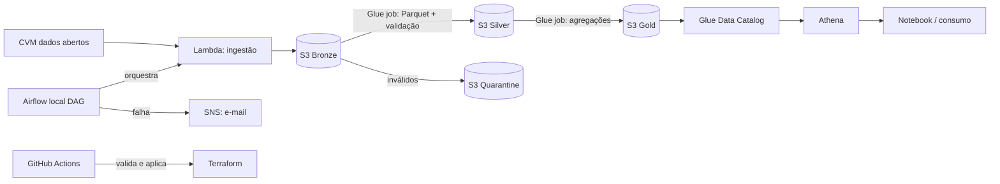

# aws-fundos-pipeline

Pipeline de dados orquestrado na **AWS** com **Terraform** (IaC) e **CI/CD**, sobre os Dados Abertos da CVM (informe diário e cadastro de fundos).

> Status: 🚧 em desenvolvimento (Épico 1: Fundações e conta AWS)

## Problema
Disponibilizar, de forma automatizada e confiável, dados públicos de fundos de investimento para análise.

## Arquitetura


## Como rodar (3 comandos)
```bash
make tf-apply                   # provisiona a infraestrutura (Terraform)
make airflow-up                 # sobe o Airflow local
make trigger COMPETENCIA=2026-09
```
Ao terminar a sessão: `make tf-destroy` (R-02: evitar custo inesperado).

## Resultados medidos
_A preencher: tempo da DAG, custo mensal real (meta ≤ US$ 5)._

## Decisões
Ver [`docs/adr/`](docs/adr/).

## Limitações
_A preencher._
