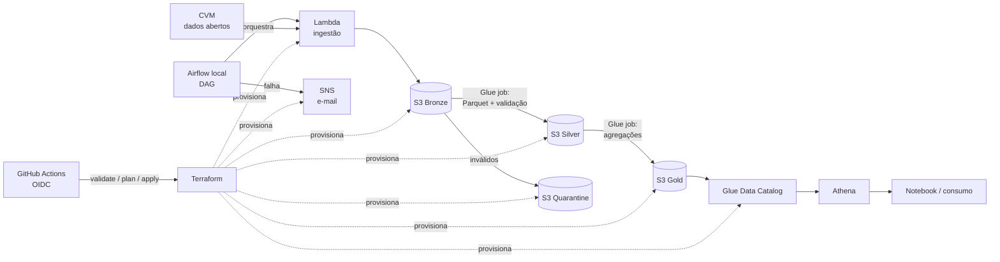

# aws-fundos-pipeline

[](https://github.com/thalesreiser/aws-fundos-pipeline/actions/workflows/ci.yml)


[](LICENSE)

> Pipeline de dados na **AWS**, 100% provisionado com **Terraform**, orquestrado por **Airflow** e entregue com **CI/CD**, que transforma os dados abertos de fundos de investimento da CVM em tabelas analíticas consultáveis no Athena, por menos de US$ 5 por mês.

**Status:** 🚧 em desenvolvimento · Épico 1 de 7 (Fundações e conta AWS)

> 🇬🇧 **In English:** A serverless data pipeline on **AWS** (Lambda, S3, Glue, Athena), fully provisioned with **Terraform**, orchestrated by **Airflow** and shipped through **GitHub Actions with OIDC**. It turns the Brazilian Securities Commission (CVM) open data on investment funds into queryable analytics tables, with idempotent reprocessing, quarantine for invalid records and a cost target under US$ 5/month.

---

## Por que este projeto existe

A CVM publica diariamente o **informe diário** de milhares de fundos de investimento (valor da cota, patrimônio líquido, captações, resgates e número de cotistas), além do **cadastro** desses fundos. Os dados são ricos, mas chegam como CSVs mensais, sem histórico consolidado e sem nenhuma garantia de qualidade.

Este projeto constrói o caminho completo da fonte até a consulta, com as práticas que se espera de um pipeline em produção:

- **Infraestrutura como código:** nenhum recurso criado à mão no console
- **Idempotência:** reprocessar um mês dá exatamente o mesmo resultado
- **Qualidade com quarentena:** registros inválidos são isolados, não descartados em silêncio
- **Segurança por padrão:** menor privilégio, criptografia e CI sem chaves de longa duração
- **Custo sob controle:** orçamento com alerta e `terraform destroy` documentado

## Arquitetura



### Organização no S3

```
s3://<projeto>-bronze/informe_diario/ano=2026/mes=09/inf_diario_fi_202609.csv
s3://<projeto>-bronze/cadastro/data_carga=2026-10-16/cad_fi.csv
s3://<projeto>-silver/informe_diario/ano=2026/mes=09/part-*.parquet
s3://<projeto>-quarantine/informe_diario/ano=2026/mes=09/...
s3://<projeto>-gold/indicadores_fundo_mes/ano=2026/mes=09/part-*.parquet
```

O particionamento por **ano/mês** permite reprocessar uma competência sobrescrevendo só a partição dela, que é o que garante a idempotência (RNF-01).

### Indicadores da camada gold

Por fundo e por mês:

| Indicador | Definição |
|---|---|
| **Patrimônio líquido** | PL no último dia útil do mês |
| **Captação líquida** | Σ captações − Σ resgates no período |
| **Variação da cota** | cota no fim do mês ÷ cota no fim do mês anterior − 1 |

A chave do informe é **CNPJ do fundo + data de competência** (RN-01).

## Destaques técnicos

| Tema | O que é demonstrado |
|---|---|
| **Terraform** | Backend remoto de estado, buckets por camada com criptografia e bloqueio público, roles IAM de menor privilégio, Glue Database, SNS e AWS Budgets |
| **CI/CD** | `terraform fmt`, `validate` e `plan` no PR; autenticação na AWS via **OIDC** (sem *access keys* guardadas) |
| **Airflow** | DAG com dependências, *retries*, *backfill* e reexecução idempotente |
| **Qualidade** | Regras com **pandera** (schema, nulos, duplicidade, faixas) e quarentena |
| **Testes** | Unitários com pytest, integração com **moto** simulando S3, `tflint` |
| **Observabilidade** | Logs estruturados e métricas no CloudWatch, alerta de falha por e-mail |

## Custos

| Recurso | Estratégia para manter o custo baixo |
|---|---|
| Lambda, S3, Athena | Dentro ou perto do free tier para este volume |
| Glue | Jobs Python com capacidade mínima e execução sob demanda |
| Airflow | Roda **local** em Docker. O MWAA teria custo fixo mensal (ver ADR 002) |
| Proteção | AWS Budgets com alerta em 80% e `make tf-destroy` ao fim de cada sessão |

**Meta:** ≤ US$ 5/mês. O custo real medido será publicado aqui.

## Stack

| Camada | Tecnologia |
|---|---|
| Ingestão | AWS Lambda (Python) |
| Armazenamento | Amazon S3 (bronze, silver, gold, quarantine) |
| Transformação | AWS Glue (job Python) |
| Catálogo e consulta | Glue Data Catalog + Amazon Athena |
| Orquestração | Apache Airflow (Docker Compose local) |
| IaC | Terraform |
| CI/CD | GitHub Actions + OIDC |
| Qualidade | pandera + pytest + moto |
| Observabilidade | CloudWatch + SNS |

## Como rodar

**Pré-requisitos:** conta AWS (com MFA e usuário não-root), Terraform ≥ 1.6, Docker e Python 3.11.

```bash
make tf-apply                     # provisiona a infraestrutura
make airflow-up                   # sobe o Airflow local
make trigger COMPETENCIA=2026-09  # processa um mês ponta a ponta
```

Ao terminar: **`make tf-destroy`**.

Para desenvolver: `make install`, `make lint`, `make test` e `make tf-plan`.

## Estrutura do repositório

```
├── src/fundos_pipeline/
│   ├── ingestion/        # Lambdas: informe diário e cadastro
│   ├── transform/        # Jobs Glue: silver e gold
│   └── quality/          # Regras pandera e quarentena
├── airflow/dags/         # DAG de orquestração (separada da lógica)
├── infra/terraform/      # Toda a infraestrutura AWS
├── tests/                # Unitários e integração com moto
├── notebooks/            # Exemplo de consumo da gold
├── docs/                 # Requisitos (01–06) e ADRs
└── .github/workflows/    # CI: Python + Terraform
```

## Roadmap

| Épico | Entrega | Horas | Status |
|---|---|---|---|
| 1. Fundações e conta AWS | Repositório, conta segura, Budgets, visão e requisitos | 5 h | 🚧 |
| 2. Infraestrutura como código | State remoto, S3, IAM, Glue, SNS, `plan` no CI | 7 h | ⬜ |
| 3. Ingestão | Lambdas do informe e do cadastro, testes com moto | 6 h | ⬜ |
| 4. Transformação e qualidade | Glue silver/gold, pandera, quarentena, reconciliação | 9 h | ⬜ |
| 5. Orquestração | Airflow, DAG, idempotência, alerta de falha | 6 h | ⬜ |
| 6. Consumo | Tabelas e views no Athena, notebook | 3 h | ⬜ |
| 7. CI/CD e publicação | Pipeline completo, ADRs, custo real, README final | 4 h | ⬜ |

## Resultados medidos

| Métrica | Meta | Medido |
|---|---|---|
| `terraform apply` + execução da DAG | ≤ 30 min | — |
| Reexecução da mesma competência | 0 duplicatas | — |
| Custo mensal | ≤ US$ 5 | — |

## Documentação

| Documento | Conteúdo |
|---|---|
| [01 - Visão e escopo](docs/01-visao-e-escopo.md) | Problema, objetivo, escopo e métricas de sucesso |
| [02 - Análise e priorização](docs/02-analise-e-priorizacao.md) | Requisitos (MoSCoW), regras, restrições e riscos |
| [03 - Especificação](docs/03-especificacao.md) | User stories em Gherkin e modelo de dados |
| [04 - Arquitetura](docs/04-arquitetura.md) | C4 simplificado |
| [05 - Validação](docs/05-validacao.md) | Execução dos critérios de aceite |
| [06 - Rastreabilidade](docs/06-rastreabilidade.md) | Requisito → componente → teste |
| [ADRs](docs/adr/) | Glue Python vs Spark, Airflow local vs MWAA, particionamento, idempotência |

## Projetos relacionados

| # | Projeto | Foco |
|---|---|---|
| P2 | [spark-cnpj-lakehouse](https://github.com/thalesreiser/spark-cnpj-lakehouse) | Processamento distribuído com Spark e Delta Lake |
| **P1** | **aws-fundos-pipeline** (este) | Pipeline na AWS com Terraform, Airflow e CI/CD |
| P3 | [dbt-dw-api](https://github.com/thalesreiser/dbt-dw-api) | Data warehouse com dbt e API REST, que consome a gold deste projeto |

## Licença

Código sob a licença [MIT](LICENSE): pode ser usado, copiado e modificado, inclusive comercialmente, desde que o aviso de copyright de **Thales Reiser Pedreira** seja mantido. Regras sobre os dados e a segurança estão em [`POLITICA-DE-USO.md`](POLITICA-DE-USO.md).

## Autor

**Thales Reiser Pedreira**, Engenheiro de Dados e de Software · Python, SQL, AWS e Big Data.
[GitHub](https://github.com/thalesreiser) · [LinkedIn](https://www.linkedin.com/in/thalesreiserpedreira)
